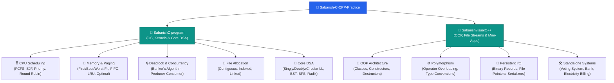
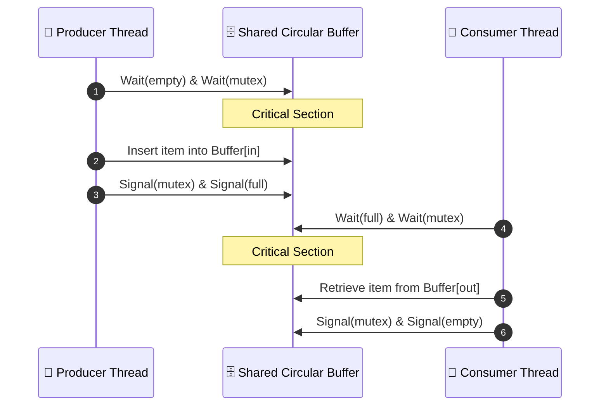
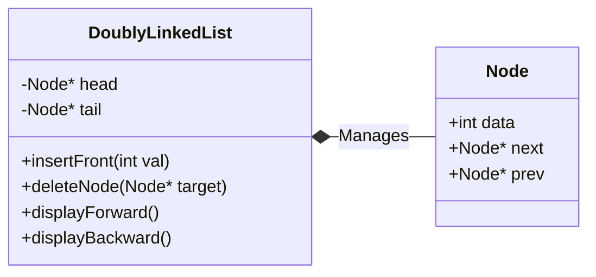

<div align="center">

# ⚡ Systems Programming, Data Structures & OOP in C / C++

[](https://en.wikipedia.org/wiki/C_(programming_language))
[](https://en.wikipedia.org/wiki/C%2B%2B)
[](https://gcc.gnu.org/)
[](https://github.com/SabarishMS123/Sabarish-C-CPP-Practice)

<p align="center">
  <strong>A comprehensive engineering repository covering low-level operating system algorithms, classic data structures, sorting routines, and robust Object-Oriented Software Design patterns.</strong>
</p>

[System Architecture](#-repository-architecture) •
[Operating Systems Engine](#-operating-systems--concurrency) •
[Data Structures & Algorithms](#-data-structures--algorithms) •
[Object-Oriented C++ Suite](#-advanced-c--object-oriented-design) •
[Build & Execution](#-build--execution-guide) •
[Repository Hygiene](#-repository-maintenance--hygiene)

---

</div>

## 📌 Executive Summary

This repository aggregates hands-on implementations written in **C** and **C++**, focusing on low-level resource management, algorithmic complexity, and foundational software engineering principles. It bridges theoretical hardware abstractions with deterministic software design:

- **Operating System Subsystems**: CPU Scheduling, Deadlock Avoidance, Page Replacement, and File Allocation strategies.
- **Fundamental Data Structures**: Custom dynamic linked lists, binary search trees, and memory-safe traversals.
- **Sorting & Searching Algorithms**: Divide-and-conquer, non-comparative sorting, and graph traversals.
- **Modern & Classical C++**: Class construction, operator overloading, user-defined exceptions, stream manipulators, and binary I/O pipelines.

---

## 🏛 Repository Architecture



---

## 💻 Operating Systems & Concurrency

The files located inside `SabarishC program/` model fundamental operating system kernel responsibilities:

### 1. CPU Scheduling Algorithms

Mechanisms that balance throughput, turnaround time (TAT), and waiting time (WT).

```mermaid
gantt
    title CPU Scheduling Paradigms
    dateFormat X
    axisFormat %s

    section FCFS - Arrival Order
    P1 burst 4 :0, 4
    P2 burst 3 :4, 7
    P3 burst 2 :7, 9

    section Round Robin - Quantum 2
    P1 Q1 :0, 2
    P2 Q1 :2, 4
    P3 Q1 :4, 6
    P1 Q2 :6, 8
    P2 Q2 :8, 9
```



1. `fcfs.c` / `fcfsme.c`: First-Come, First-Served non-preemptive queue execution.
2. `sjf.c` / `sjf1.c` / `sjfme.c`: Shortest Job First scheduling minimizing average wait time.
3. `priority.c` / `priorityme.c` / `priorityscheduling.c`: Priority-driven CPU scheduling resolving static process weights.
4. `roundrobin.c` / `roundrobin1.c`: Preemptive time-sharing scheduler utilizing a fixed time quantum (`q`) to prevent starvation.

### 2. Synchronization & Deadlock Management



1. `bankersproblem.c`: Implementation of Dijkstra's Banker's Algorithm for deadlock avoidance. Tests safety vectors:

   ```
   NEED[i][j] = MAX[i][j] - ALLOCATION[i][j]
   ```

   Ensures the state transactions strictly satisfy `Need <= Work`.

2. `producerconsumeros.c`: Classic bounded-buffer concurrency problem using semaphores to eliminate race conditions.
3. `systemcall.c`: Direct process manipulation via POSIX interfaces (`fork()`, `exec()`, `wait()`).

### 3. Memory & Storage Management

**Page Replacement:**

- `fifo.c`: First-In, First-Out queue-based page replacement.
- `lru.c`: Least Recently Used algorithm tracking reference locality.
- `optimal.c`: Belady's Optimal algorithm providing the theoretical minimum page-fault benchmark.

**Dynamic Partition Allocation:**

- `firstfit.c` / `firstbestworst.c` / `newbit,wfit,ffit.c`: Evaluates internal/external fragmentation across First-Fit, Best-Fit (smallest fitting partition), and Worst-Fit (largest available hole).

**Secondary Storage File Allocation:**

- `contigousos.c`: Contiguous sector allocation requiring continuous disk blocks.
- `linkedallocfile.c`: Non-contiguous block tracking using pointer chains, removing external fragmentation.
- `indexedalloc.c`: Direct block address indexing using dedicated inode-style index blocks.

---

## 🌲 Data Structures & Algorithms



### Modules Breakdown

| Subsystem | File References | Time Complexity | Core Concepts |
| :--- | :--- | :--- | :--- |
| **Linked Lists** | `singlylinkedmam.c`, `doublyLL.c`, `circular.c` | Insertion: $\mathcal{O}(1)$ · Lookup: $\mathcal{O}(n)$ | Pointer manipulation, boundary conditions, heap allocation. |
| **Trees & Graphs** | `bst.c`, `BFS.c` | BST Search: $\mathcal{O}(\log n)$ · BFS: $\mathcal{O}(V + E)$ | Recursive binary partitions, queue-driven breadth-first traversal. |
| **Sorting** | `bubblesort.c`, `radix.c`, `quicksort.c` | Radix: $\mathcal{O}(d \cdot (n + k))$ · Quicksort: $\mathcal{O}(n \log n)$ | Comparative vs. distribution sorts, pivot partitioning. |
| **Polynomial Math** | `polyadd.c` | Addition: $\mathcal{O}(m + n)$ | Linked representation of multi-degree symbolic algebra. |

---

## 🛡 Advanced C++ & Object-Oriented Design


### Key Engineering Paradigms

**Encapsulation & Resource Lifecycles:**

- `classobj.cpp`, `constructordestructor.cpp`: RAII principles and custom constructor/destructor pairs.
- `Timeclass.cpp`, `complexwithscalar.cpp`: Abstract data types (ADTs) with private invariants.

**Polymorphism & Operator Mechanics:**

- `operator overloading.cpp`, `binary operator.cpp`: Custom arithmetic semantics (`+`, `-`, `*`).
- `insertionextractionoverloading.cpp`: Overloaded `operator<<` and `operator>>` for formatted stream I/O.
- `type conversion.cpp`: Explicit and implicit conversions (Class-to-Basic, Basic-to-Class, Class-to-Class).

**Data Serialization & File I/O:**

- `filehandling.cpp`, `copycontentbinaryandtext.cpp`: Binary buffer handling and random access using `seekg()` and `seekp()`.
- `employees.cpp` / `employeesfile.cpp`: Fixed-width struct records persisted directly to binary `.dat` storage.

**Defensive Programming:**

- `exceptionuser.cpp`: Custom exception hierarchies inheriting from `std::exception`.

**Applied Domain Applications:**

- `votingsystem.cpp`: Authenticated ballot state-machine and vote tallies.
- `bank.cpp`: Balance updates with transactional validation.
- `KitchenGoodsManager.cpp`: Modular inventory and entity management.

---

## 🚀 Build & Execution Guide

### Prerequisites

GCC / G++ (MinGW-w64 on Windows or native GCC on Linux)

### 1. Compile C Subsystems

```bash
# Compile Banker's Algorithm with standard warnings enabled
gcc -Wall -Wextra -pedantic "SabarishC program/bankersproblem.c" -o bankersproblem

# Execute
./bankersproblem
```

### 2. Compile C++ Modules

```bash
# Compile Employee Record File System
g++ -std=c++17 -Wall -Wextra "SabarishvisualC++/employeesfile.cpp" -o employeesfile

# Execute
./employeesfile
```

---

## 🧹 Repository Maintenance & Hygiene

### Recommended `.gitignore`

Add this `.gitignore` to the root directory to keep binaries and editor caches out of source control:

```gitignore
# Compiled Object & Executable files
*.exe
*.o
*.obj
*.out
*.app

# Temporary and IDE cache files
.vscode/
tempCodeRunnerFile.*
*.txt.txt

# Binary Data caches
*.dat
!employees.dat
```

### Purge Already-Committed Binaries

Remove checked-in `.exe` files from Git tracking without deleting your local copies:

```bash
git rm --cached *.exe "SabarishC program/*.exe" "SabarishvisualC++/*.exe"
git commit -m "build: prune compiled binary artifacts from version control"
```

---

## 🌐 Connect & Location

<div align="center">

**📍 Salem, Tamil Nadu, India**

[](https://sabarishdev.netlify.app/)
[](https://github.com/SabarishMS123)

</div>

---

<div align="center">

**Developed by Sabarish M S**

Computer Science & Engineering • Systems Programming • Algorithmic Design

<sub>Built with C99 & C++17 • Salem, TN, India</sub>

</div>
