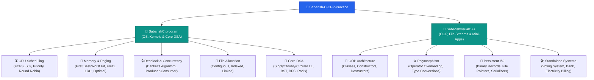
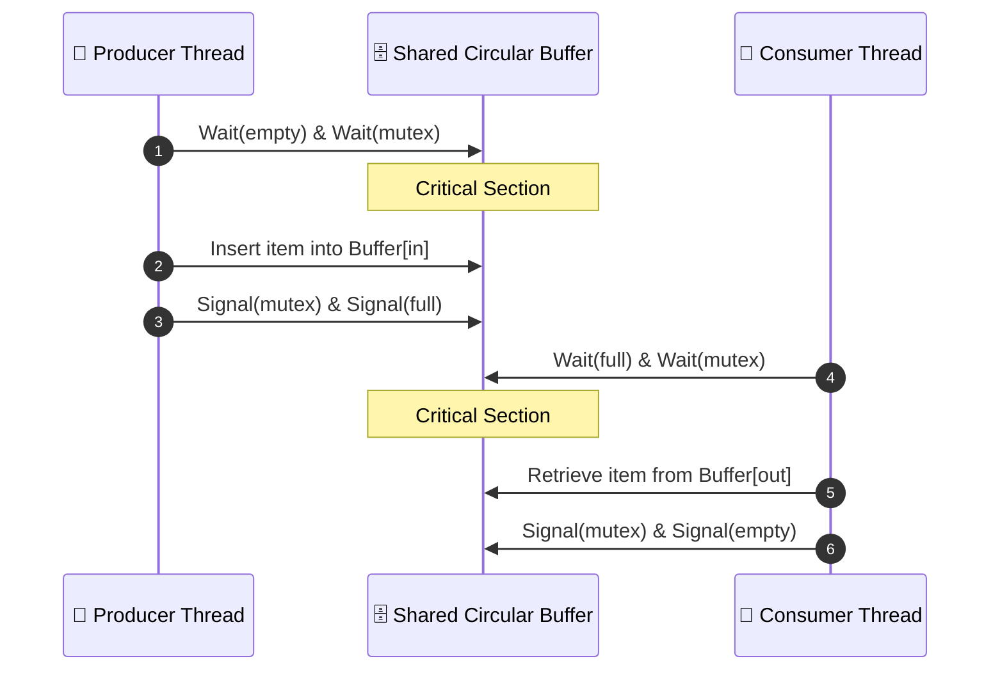
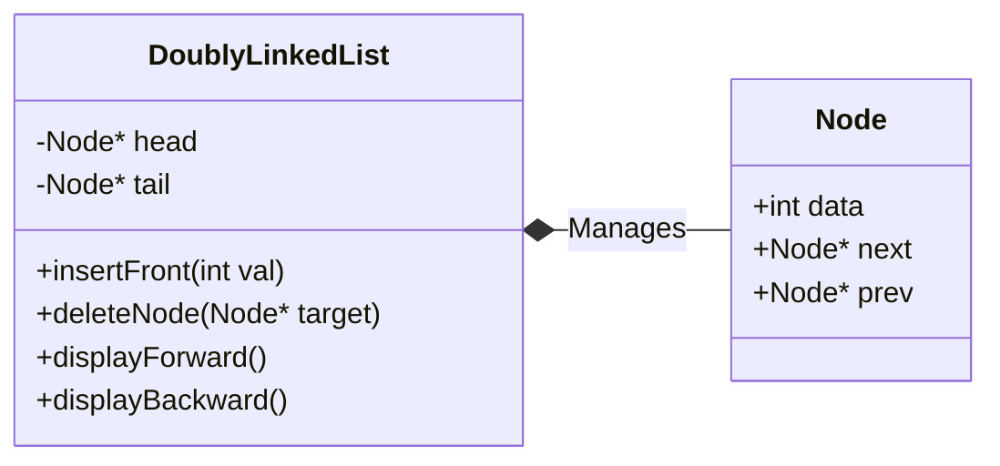
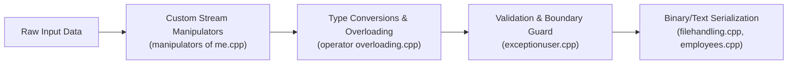

```
<div align="center">

# ⚡ Systems Programming, Data Structures & OOP in C / C++

[](https://en.wikipedia.org/wiki/C_(programming_language))
[](https://en.wikipedia.org/wiki/C%2B%2B)
[](https://gcc.gnu.org/)
[](https://github.com/SabarishMS123/Sabarish-C-CPP-Practice)

<p align="center">
  <strong>A comprehensive engineering repository covering low-level operating system algorithms, classic data structures, sorting routines, and robust Object-Oriented Software Design patterns.</strong>
</p>

[System Architecture](#-repository-architecture) •
[Operating Systems Engine](#-operating-systems--concurrency) •
[Data Structures & Algorithms](#-data-structures--algorithms) •
[Object-Oriented C++ Suite](#-advanced-c--object-oriented-design) •
[Build & Execution](#-build--execution-guide) •
[Repository Hygiene](#-repository-maintenance--hygiene)

---

</div>

## 📌 Executive Summary

This repository aggregates hands-on implementations written in **C** and **C++**, focusing on low-level resource management, algorithmic complexity, and foundational software engineering principles. It bridges the gap between theoretical hardware abstractions and deterministic software design:

- **Operating System Subsystems**: CPU Scheduling, Deadlock Avoidance, Page Replacement, and File Allocation strategies.
- **Fundamental Data Structures**: Custom dynamic linked lists, binary search trees, and memory-safe traversals.
- **Sorting & Searching Algorithms**: Divide-and-conquer, non-comparative sorting, and graph traversals.
- **Modern & Classical C++**: Class construction, operator overloading, user-defined exceptions, stream manipulators, and binary I/O pipelines.

---

## 🏛 Repository Architecture



---

## 💻 Operating Systems & Concurrency

The files located inside `SabarishC program/` model the fundamental responsibilities of operating system kernels:

### 1. CPU Scheduling Algorithms

Mechanisms that balance throughput, turnaround time ($TAT$), and waiting time ($WT$).

```mermaid
gantt
    title CPU Scheduling Paradigms
    dateFormat  X
    axisFormat %s

    section FCFS (Arrival Order)
    P1 (Burst: 4) :0, 4
    P2 (Burst: 3) :4, 7
    P3 (Burst: 2) :7, 9

    section Round Robin (Quantum = 2)
    P1 [Q1]       :0, 2
    P2 [Q1]       :2, 4
    P3 [Q1]       :4, 6
    P1 [Q2]       :6, 8
    P2 [Q2]       :8, 9

```

* **`fcfs.c` / `fcfsme.c**`: First-Come, First-Served non-preemptive queue execution.
* **`sjf.c` / `sjf1.c` / `sjfme.c**`: Shortest Job First scheduling to minimize average waiting time.
* **`priority.c` / `priorityme.c` / `priorityscheduling.c**`: Priority-driven CPU scheduling resolving static process weights.
* **`roundrobin.c` / `roundrobin1.c**`: Preemptive time-sharing scheduler utilizing a fixed time quantum ($q$) to avoid starvation.

---

### 2. Synchronization & Deadlock Management



* **`bankersproblem.c`**: Implementation of Edsger Dijkstra’s Banker’s Algorithm for deadlock avoidance. Tests safety vectors:

$$\text{Need}[i][j] = \text{Max}[i][j] - \text{Allocation}[i][j]$$


Ensuring state transitions satisfy $\text{Need} \le \text{Work}$.
* **`producerconsumeros.c`**: Classic bounded-buffer concurrency problem using semaphores/mutex abstractions to eliminate race conditions.
* **`systemcall.c`**: Direct process manipulation via POSIX/system API interfaces (`fork()`, `exec()`, `wait()`).

---

### 3. Memory & Storage Management

* **Page Replacement**:
* **`fifo.c`**: First-In, First-Out queue-based replacement.
* **`lru.c`**: Least Recently Used algorithm tracking reference locality.
* **`optimal.c`**: Belady's Optimal algorithm providing the theoretical minimum page fault benchmark.


* **Dynamic Partition Allocation**:
* **`firstfit.c` / `firstbestworst.c` / `newbit,wfit,ffit.c**`: Evaluates fragmentation overheads across First-Fit, Best-Fit (smallest fitting hole), and Worst-Fit (largest available block).


* **Secondary Storage File Allocation**:
* **`contigousos.c`**: Models contiguous sector allocation requiring continuous disk blocks.
* **`linkedallocfile.c`**: Implements non-contiguous block tracking using pointers, removing external fragmentation.
* **`indexedalloc.c`**: Direct address indexing via dedicated inode-like pointer blocks.


---

## 🌲 Data Structures & Algorithms

Production code demands predictable memory layouts and cache locality.



### Modules Breakdown

| Subsystem | File References | Time Complexity | Core Concepts |
| --- | --- | --- | --- |
| **Linked Lists** | `singlylinkedmam.c`, `doublyLL.c`, `circular.c` | Insertion: $\mathcal{O}(1)$<br>

<br>Lookup: $\mathcal{O}(n)$ | Pointer manipulation, boundary checks, traversal without memory leaks. |
| **Trees & Graphs** | `bst.c`, `BFS.c` | BST Search: $\mathcal{O}(\log n)$<br>

<br>BFS: $\mathcal{O}(V + E)$ | Recursive/iterative tree balancing, FIFO queue-based graph traversals. |
| **Sorting** | `bubblesort.c`, `radix.c`, `quicksort.c` | Radix: $\mathcal{O}(d \cdot (n + k))$<br>

<br>Quicksort: $\mathcal{O}(n \log n)$ | Comparative vs. non-comparative sorts, partitioning schemes. |
| **Polynomial Math** | `polyadd.c` | Addition: $\mathcal{O}(m + n)$ | Linked representation of multi-degree symbolic algebra. |

---

## 🛡 Advanced C++ & Object-Oriented Design

The `SabarishvisualC++` directory implements design patterns and object-oriented mechanics in modern C++.



### Key Engineering Paradigms Demonstrated

1. **Encapsulation & Resource Lifecycles**:
* `classobj.cpp`, `constructordestructor.cpp`: Strict RAII (Resource Acquisition Is Initialization) semantics.
* `Timeclass.cpp`, `complexwithscalar.cpp`: Abstract data types (ADTs) with clean public APIs and encapsulated state.


2. **Polymorphism & Operator Mechanics**:
* `operator overloading.cpp`, `binary operator.cpp`: Custom arithmetic semantics (`+`, `-`, `*`).
* `insertionextractionoverloading.cpp`: Overloaded `operator<<` and `operator>>` for seamless stream I/O formatting.
* `type conversion.cpp`: Explicit and implicit user-defined type conversions (Class-to-Basic, Basic-to-Class, and Class-to-Class).


3. **Data Serialization & File I/O Systems**:
* `filehandling.cpp`, `copycontentbinaryandtext.cpp`: Binary buffer copies, random access using `seekg()` and `seekp()`.
* `employees.cpp` / `employeesfile.cpp`: Complete database-like CRUD system writing fixed-width struct records to persistent `.dat` binary files.


4. **Resilience & Defensive Programming**:
* `exceptionuser.cpp`: Custom exception hierarchies inheriting from `std::exception` to catch boundary errors cleanly.


5. **Applied Domain Applications**:
* `votingsystem.cpp`: State-driven console application managing authenticated ballots and tallying.
* `bank.cpp`: Atomic account balance updates with strict transaction validation.
* `KitchenGoodsManager.cpp`: Inventory state tracking using modular OOP concepts.


---

## 🚀 Build & Execution Guide

### Prerequisites

* GCC / G++ (MinGW-w64 for Windows or native GCC on Linux)
* Make or CMake (optional, standard CLI commands provided below)

### 1. Compile C Subsystems (Linux / Windows CLI)

```bash
# Compile Banker's Algorithm with all warnings enabled
gcc -Wall -Wextra -pedantic "SabarishC program/bankersproblem.c" -o bankersproblem

# Execute
./bankersproblem

```

### 2. Compile C++ OOP Modules

```bash
# Compile Employee Record File System
g++ -std=c++17 -Wall -Wextra "SabarishvisualC++/employeesfile.cpp" -o employeesfile

# Execute
./employeesfile

```

---

## 🧹 Repository Maintenance & Hygiene

Noticeable in this repository are pre-compiled `.exe` artifacts and temporary debugger output files (e.g., `tempCodeRunnerFile.cpp`, `Untitled1.exe`).

To make your repository clean and production-ready for technical recruiters, consider adding a `.gitignore` to the project root and purging untracked binaries:

### Recommended `.gitignore`

```gitignore
# Compiled Object & Executable files
*.exe
*.o
*.obj
*.out
*.app

# Temporary and IDE cache files
.vscode/
tempCodeRunnerFile.*
*.txt.txt

# Persistence / Local Data caches
*.dat
!employees.dat

```

### Quick Cleanup Command (Git Bash / Linux)

```bash
# Untrack all checked-in executables without deleting local code
git rm --cached *.exe "SabarishC program/*.exe" "SabarishvisualC++/*.exe"
git commit -m "build: prune compiled binary artifacts from version control"

```

---

**Developed by [Sabarish M S**](https://www.google.com/search?q=https://github.com/SabarishMS123)

*Computer Science & Engineering • Systems Programming • Algorithmic Design*
